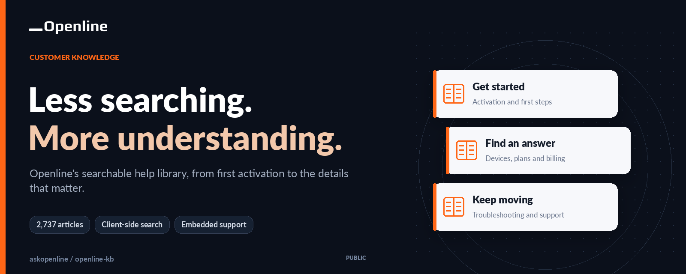
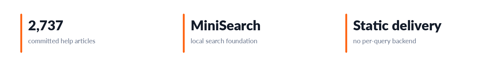
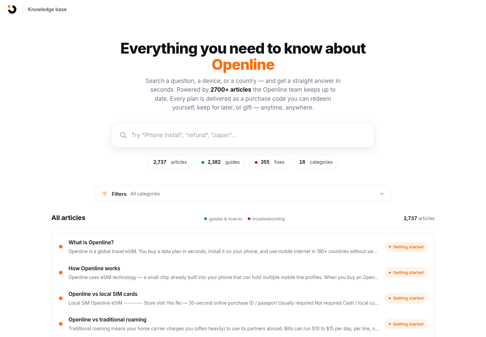
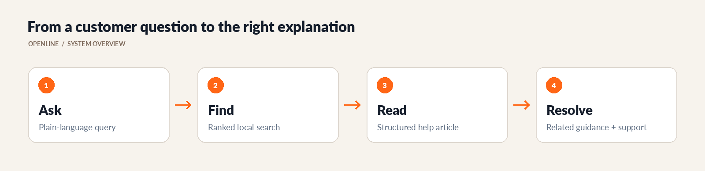
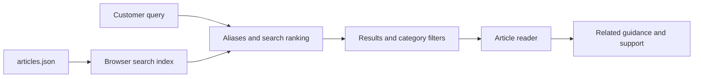

# Openline Knowledge Base

<!-- CUP-OF-NEWS-STYLE -->
<div align="center">

[](https://openline.com)
[](https://github.com/askopenline/openline-kb)
[](https://github.com/askopenline/openline-kb/releases)
[](#architecture)
[](LICENSE)




**Openline's searchable help library, from first activation to the details that matter.**

[Company website](https://openline.com) · [Project overview](https://kb.openline.com) · [Release history](https://github.com/askopenline/openline-kb/releases) · [Contribution guide](.github/OPENLINE-CONTRIBUTING.md)

</div>

---

Openline's customer-help library, built to make a large body of eSIM knowledge easy to browse and search. The committed corpus contains **2,737 articles**, with a standalone help interface and an embeddable reference for use inside a broader support experience.

<p align="center">
  <a href="https://kb.openline.com"><strong>Open the knowledge base</strong></a> ·
  <a href="#experience">Explore the interface</a> ·
  <a href="#quick-start">Run locally</a> ·
  <a href="#editorial-workflow">Editorial workflow</a> ·
  <a href="https://github.com/askopenline/openline-kb/releases">Releases</a>
</p>



---

## Experience

The interface supports both open-ended questions and structured browsing. Articles, categories, subcategories, and search aliases are maintained separately from the visual shell so the library can evolve without rebuilding an application backend.

| Capability | What it provides |
| --- | --- |
| Broad help corpus | Setup, activation, devices, troubleshooting, plans, billing, and related guidance |
| Client-side search | Local indexing and ranking without a server request for each query |
| Typo and prefix matching | More forgiving discovery of product terms and device names |
| Category navigation | A structured path when a customer is not sure what to search for |
| Article presentation | A focused reader for the supported Markdown content |
| Modal reference | A full-screen embedding pattern for another Openline surface |
| Regression tooling | A committed search audit for repeatable checks |



---

## From a question to an explanation



Search is designed to help customers reach a useful explanation, not to turn an unrelated fallback result into a guaranteed answer. The corpus and ranking behavior both need review when product terminology or policy changes.

---

## Architecture

The application is static and the search index is built in the browser. There is no application build step and no dedicated search service to operate.



| File | Responsibility |
| --- | --- |
| [`articles.json`](articles.json) | Article content, taxonomy, and tags |
| [`app.js`](app.js) | Browsing, article display, filters, and keyboard interactions |
| [`search.mjs`](search.mjs) | Ranking, prefix/fuzzy matching, and domain-specific aliases |
| [`minisearch.mjs`](minisearch.mjs) | Vendored MiniSearch implementation |
| [`index.html`](index.html) | Standalone knowledge-base entry point |
| [`modal-preview.html`](modal-preview.html) | Embedding reference |
| [`style.css`](style.css) | Application-specific presentation |
| [`audit_search.mjs`](audit_search.mjs) | Search regression checks |

---

## Quick start

Serve the repository over HTTP so that article loading and modules behave normally. No package installation is required for the existing application.

```sh
git clone https://github.com/askopenline/openline-kb.git
cd openline-kb
python3 -m http.server 8000 --bind 127.0.0.1
```

Open [the local knowledge base](http://127.0.0.1:8000) or [the modal reference](http://127.0.0.1:8000/modal-preview.html). Run the search audit from the repository root:

```sh
node audit_search.mjs
```

---

## Article format

Every article has a stable identity, a route-friendly slug, taxonomy, search tags, and a Markdown body. Preserve existing IDs and slugs when revising an article so that links and references remain useful.

```json
{
  "id": 42,
  "slug": "example-help-article",
  "category": "Getting started",
  "subcategory": "Activation",
  "title": "Example help article",
  "tags": ["activation", "setup"],
  "body": "Article content using the supported Markdown subset."
}
```

The article renderer supports a defined subset of Markdown rather than every possible extension. Check the actual reader when adding tables, links, lists, emphasis, or code examples.

---

## Editorial workflow

1. Confirm the current product behavior, policy, or device-specific instruction behind a proposed change.
2. Update the article while preserving exact technical values, qualifications, source dates, and stable identifiers.
3. Keep related articles, terminology, and support details consistent.
4. Validate the JSON and run the search regression suite.
5. Inspect the changed article and its likely queries on desktop and mobile.
6. Publish the reviewed change through the configured hosting workflow.

### Review checklist

| Check | What to verify |
| --- | --- |
| Meaning | Instructions match the actual product and do not turn a qualified statement into a universal promise |
| Structure | IDs, slugs, categories, subcategories, and tags remain valid |
| Discovery | Exact titles, common spelling variants, and relevant product terms find the intended article |
| Reader | Links, tables, lists, code, and long text remain readable |
| Integration | Modal behavior, keyboard focus, scrolling, and fallback states remain usable |
| Privacy | No customer account details, purchase codes, or private activation information enter the public corpus |

---

## Releases and support

The [company changelog](OPENLINE-CHANGELOG.md) and [GitHub releases](https://github.com/askopenline/openline-kb/releases) describe maintained snapshots. Follow the [contribution guide](.github/OPENLINE-CONTRIBUTING.md) for source changes and the [security guide](.github/OPENLINE-SECURITY.md) for sensitive reports.

Customer enquiries should use [Openline's contact page](https://openline.com/contact) or [ask@openline.com](mailto:ask@openline.com). Repository defects can be reported through [company repository issues](https://github.com/askopenline/openline-kb/issues), without personal customer information.

---

## Design and technology choices

### Content as structured data

Stable article IDs, slugs, taxonomy, and tags let editorial changes remain reviewable without mixing them into view code.

### Search in the browser

The static corpus can be indexed locally, avoiding a separate search service and per-query round trips. Initial payload and index cost still matter as the library grows.

### Audit the discovery path

Correct prose is not enough if a customer cannot find it. Search regressions and actual reader checks complement editorial review.

---

## Ownership and licenses

Openline maintains the company-authored help content and application work. The existing licensing remains unchanged:

- **Application code:** MIT, as specified in [`LICENSE`](LICENSE).
- **Article content:** Creative Commons Attribution 4.0 International, with attribution to Openline, Inc., as specified in the existing license.
- **MiniSearch:** Its MIT notice and Luca Ongaro attribution remain applicable.

The official company account is [askopenline](https://github.com/askopenline). Third-party brands and other incorporated materials retain their respective rights.
